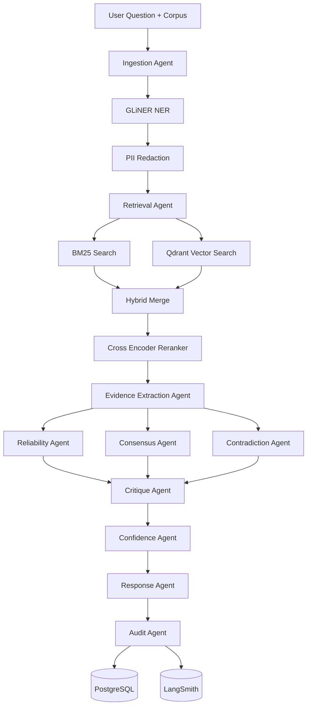

I think you're converging toward something much stronger now.

I would **not** call the final metric `relevance_score`.

You're mixing:

* Source trustworthiness
* Document relevance
* Consensus
* Recency

Those are different concepts.

Call it:

```text
Evidence Reliability Score (ERS)
```

or

```text
Evidence Confidence Score (ECS)
```

Much more accurate.

---

# High Level Architecture

```text
                    User Question
                           |
                           ▼
                  Ingestion Agent
           (PII Redaction + Validation)
                           |
                           ▼
                  Retrieval Agent
      (Hybrid Search: BM25 + Qdrant + Rerank)
                           |
                           ▼
                Evidence Extraction Agent
            (Claims, Facts, Source Metadata)
                           |
        ┌──────────────────┼──────────────────┐
        ▼                  ▼                  ▼
 Reliability Agent   Consensus Agent   Contradiction Agent
        │                  │                  │
        └──────────────────┼──────────────────┘
                           ▼
                    Critique Agent
                           |
                           ▼
                 Confidence Agent
                           |
                           ▼
                   Response Agent
                           |
                           ▼
                 Audit / Trace Agent
                           |
                           ▼
                 PostgreSQL + LangSmith
```

---

# Agent-by-Agent

---

## 1. Ingestion Agent

### Responsibility

Normalize and sanitize inputs.

### Input

```python
question
documents
metadata
```

### Processing

* File parsing
* PII redaction
* Metadata extraction
* NER using GLiNER

Examples:

```text
John Doe
john@gmail.com
+91xxxxxxxxxx
```

becomes

```text
[PERSON]
[EMAIL]
[PHONE]
```

### Output

```python
CleanDocument[]
```

---

## 2. Retrieval Agent

### Responsibility

Find relevant evidence.

### Stack

```text
Qdrant
BM25
Hybrid Retrieval
Cross Encoder Reranker
```

### Steps

1. Embed query
2. Vector search
3. BM25 search
4. Merge results
5. Rerank

Output:

```python
TopKDocuments
```

---

## 3. Evidence Extraction Agent

This is your RAG agent.

### Responsibility

Convert unstructured text into claims.

Input:

```python
documents
question
```

Output:

```python
Claim(
  statement,
  source_id,
  evidence_span
)
```

Example:

```text
Passkeys reduce phishing attacks.
```

becomes

```json
{
  "claim":"Passkeys reduce phishing attacks",
  "source":"D1"
}
```

---

# 4. Reliability Agent

Computes source reliability.

No LLM.

Pure deterministic logic.

---

## Source Type Score

```yaml
peer_reviewed: 1.0
government: 0.95
industry_standard: 0.9
news: 0.75
blog: 0.6
forum: 0.4
vendor: 0.3
```

---

## Recency Score

```python
<1 year -> 1.0
1-3 years -> 0.9
3-5 years -> 0.7
5+ years -> 0.5
```

---

Output:

```python
source_score
```

---

# 5. Consensus Agent

This is actually a very smart addition.

Most people won't think of this.

---

Input

```python
Claims
```

---

Process

Embed all claims.

Create pairwise similarity matrix.

```python
cosine(claim_i, claim_j)
```

Example:

| Claim | Similarity |
| ----- | ---------- |
| C1-C2 | 0.91       |
| C1-C3 | 0.88       |
| C1-C4 | 0.22       |

---

Consensus Score

```python
consensus_score =
average_similarity
```

Higher agreement

→ stronger evidence

---

Output

```python
consensus_score
```

---

# 6. Contradiction Agent

This is the most important node.

---

Step 1

Embed claims.

Cluster claims.

---

Step 2

For highly related claims:

```python
similarity > 0.8
```

send pair to LLM.

---

Prompt

```text
Determine relation:

SUPPORTS
CONTRADICTS
PARTIAL_CONTRADICTION
NOT_COMPARABLE
```

---

Example

```text
Passkeys eliminate phishing.

Passkeys reduce phishing.
```

Result

```json
{
  "relation":"PARTIAL_CONTRADICTION"
}
```

---

Output

```python
contradictions[]
```

---

# 7. Critique Agent (The Star)

This is the actual Skeptic.

Input:

```python
claims
source_scores
consensus_scores
contradictions
```

---

Questions it asks:

### What assumptions are being made?

### Is evidence applicable?

Example:

Question:

```text
Mobile banking users
```

Evidence:

```text
Desktop users
```

Not applicable.

---

### Are high-confidence claims supported by weak sources?

---

### Is there enough evidence?

Could answer:

```text
Insufficient Evidence
```

This should be allowed.

Very important.

---

Output

```python
skeptic_report
```

---

# 8. Confidence Agent

Computes final score.

---

I'd use:

```python
ERS =
(
 0.45 * source_score
 +
 0.35 * consensus_score
 +
 0.20 * retrieval_relevance
)
```

Then apply penalties.

---

Contradiction penalty

```python
ERS -= contradiction_penalty
```

---

Applicability penalty

```python
ERS -= applicability_penalty
```

---

Uncertainty penalty

```python
ERS -= uncertainty_penalty
```

---

Final:

```python
0.0 - 1.0
```

---

Mapping

```python
>0.8 High

0.6-0.8 Medium

<0.6 Low
```

---

# 9. Response Agent

Input

```python
skeptic_report
claims
confidence
```

Produces

```json
{
  "answer": "...",
  "confidence": "Medium",
  "evidence": [...],
  "contradictions": [...],
  "uncertainties": [...]
}
```

Matches the assignment perfectly.

---

# 10. Audit Agent

Production requirement.

Stores:

```python
question

retrieved_docs

claims

scores

contradictions

final_answer

trace_id

timestamp
```

into

```text
PostgreSQL
LangSmith
```

Supports:

* Replay
* Auditability
* Explainability

---

# Mermaid Diagram



---

One thing I'd still add: an **Applicability Agent**.

UBS literally hints that hidden test cases may contain:

* wrong population
* wrong timeframe
* wrong outcome
* wrong context

A dedicated Applicability Agent checking:

```text
Question Population
vs
Evidence Population

Question Timeframe
vs
Evidence Timeframe

Question Outcome
vs
Evidence Outcome
```

would likely score very highly because it directly addresses the hidden evaluation criteria mentioned in the brief.
