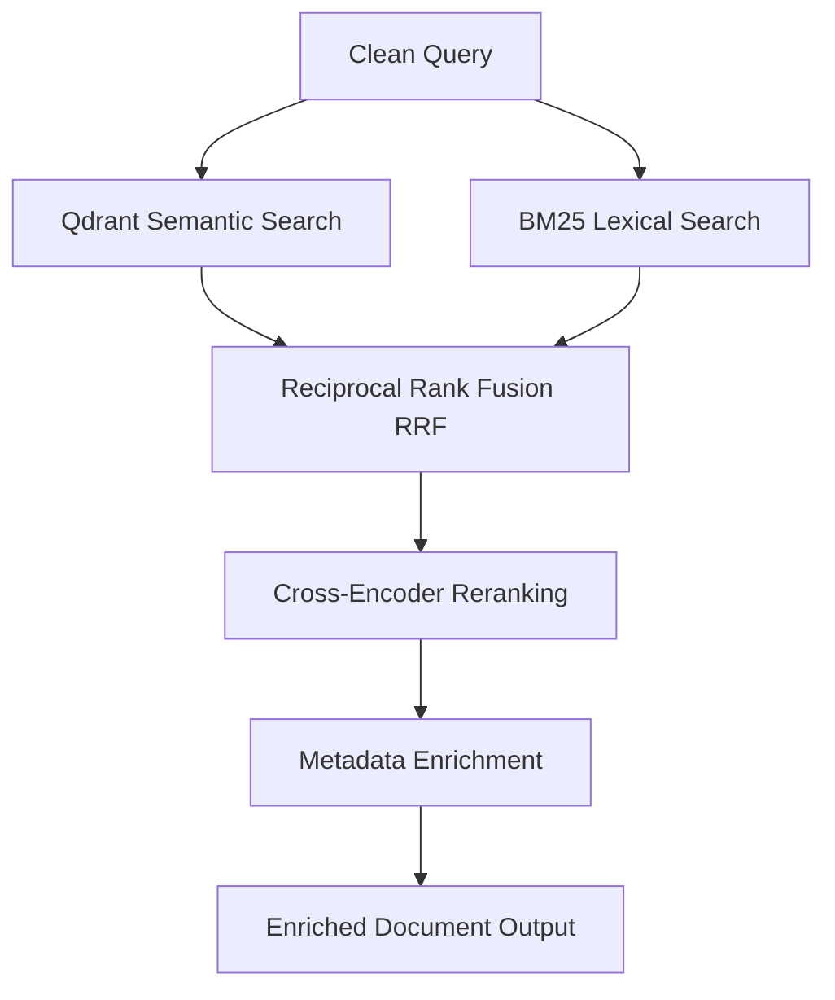

# Retrieval Agent (A2)

The Retrieval Agent executes a hybrid retrieval strategy to optimize evidence ingestion, merge lexical and semantic search ranks, rerank candidates for precision, and package enriched documents for downstream agents.

## Architectural Flow

The agent processes clean incoming search queries using the following sequential flow:



### Step 1: Parallel Search Execution
- **Qdrant Semantic Search**: Employs vector embeddings (via `gemini_service.embed`) to query Qdrant (`qdrant_service.search`) to match abstract concepts and context.
- **BM25 Lexical Search**: Fetches the document corpus using Qdrant scroll and evaluates lexical term frequencies against the tokenized query (`BM25Okapi`).

### Step 2: Hybrid Merging (Reciprocal Rank Fusion - RRF)
- Combines the candidate sets returned from semantic and lexical queries.
- Computes RRF scores using the formula:
  $$\text{RRF Score}(d) = \sum_{m \in \text{Rankers}} \frac{1}{k + \text{Rank}_m(d)}$$
  (with $k = 60$).
- Rank-orders the unified candidates based on final RRF score descending.

### Step 3: Cross-Encoder Reranking
- Uses a Transformer-based cross-encoder (`cross-encoder/ms-marco-MiniLM-L-6-v2`) to compute deep relevance scores on pairs of `(query, document_text)`.
- Updates the scores and performs a final sort to optimize precision.
- **Robust Fallback**: If `sentence-transformers` is unavailable or fails at runtime, logs a warning and proceeds with RRF-ordered candidates without crashing the pipeline.

### Step 4: Metadata Enrichment
- Annotates document objects with structured payload fields to fulfill the strict specifications of downstream agents:
  - **Reliability Agent (A4)**: `source_type` (e.g. RCT, systematic review), `publication_date`, `year` (extracted as integer), and author credentials.
  - **Applicability Agent (A7)**: Raw text blocks to map population, timeline, and outcome context.
  - **Consensus Agent (A5) & Contradiction Agent (A6)**: Context flags, retrieval scores, and identifier fields.

### Step 5: Final Output
- Returns a structured list of dictionaries matching the Retrieval Agent contract:
  ```python
  list[dict(id=str, score=float, payload=dict)]
  ```
