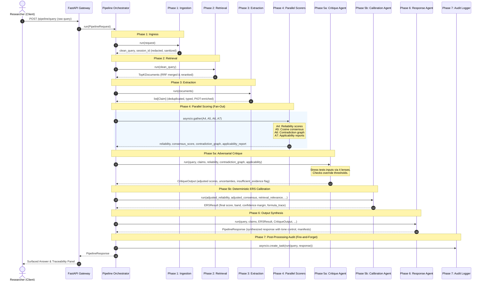

# ERS Evidence Evaluation Pipeline
## System Architecture & Technical Presentation

---

## 1. Problem Statement

Modern financial institutions, cybersecurity operations, and analytical teams rely heavily on Large Language Models (LLMs) to answer critical research questions (e.g., *"How secure is biometric voice authentication against synthetic voice cloning?"*). However, typical Retrieval-Augmented Generation (RAG) systems fail in mission-critical environments due to several core limitations:

* **Epistemic Dilution**: Traditional RAG systems treat all retrieved documents equally, trusting a low-quality blog post or vendor advertisement as much as a peer-reviewed systematic review.
* **Semantic Consensus Fallacy**: RAG architectures often measure agreement based on simple semantic similarity. If three marketing articles repeat the exact same unverified claim, the model perceives high consensus, ignoring the lack of independent validation (citation cascade).
* **Undetected Contradictions**: Information sources frequently report conflicting data. Standard LLM generators attempt to smooth over, ignore, or average out these contradictions, resulting in muddled, compromise-heavy, or misleading answers.
* **Temporal Decay & Obsoletion**: In cybersecurity and FinTech, threat models evolve rapidly. An article written in 2021 describing SMS-OTP as "satisfactory" is obsolete in 2024 due to SIM-swap advances, yet traditional vectors fail to down-weight it.
* **Applicability & Demographic Mismatches**: Study populations frequently deviate from the target audience. For instance, testing biometric sensors on young, healthy individuals does not translate to elderly demographics whose prints or voices have decayed.
* **The "Black-Box" Provability Problem**: Generating an answer with standard inline citations provides no auditable certificate of reliability. Auditors and compliance officers cannot trace *why* a source was trusted, how conflicting data was resolved, or what mathematical confidence was calculated.

---

## 2. Our Proposed Solution

The **Evidence Reliability Score (ERS) Pipeline** is a modular, multi-agent evaluation pipeline that analyzes, scores, critique-validates, and synthesizes evidence. It replaces simple text generation with a transparent **evidence quality certificate**.

Instead of a single monolithic prompt, our solution routes inputs through **11 specialized agents across 7 sequential phases**:

```
 ┌──────────────┐      ┌──────────────┐      ┌──────────────┐
 │   Ingress    │ ───> │  Retrieval   │ ───> │  Extraction  │
 │ (Phase 1:A1) │      │ (Phase 2:A2) │      │ (Phase 3:A3) │
 └──────────────┘      └──────────────┘      └──────────────┘
                                                    │
                                                    ▼
                                             ┌──────────────┐
                                             │ Parallel     │
                                             │ Scoring      │
                                             │ (Phase 4)    │
                                             │  - A4, A5    │
                                             │  - A6, A7    │
                                             └──────────────┘
                                                    │
                                                    ▼
 ┌──────────────┐      ┌──────────────┐      ┌──────────────┐
 │ Post-Audit   │ <─── │ Output Synth │ <─── │ Adversarial  │
 │ (Phase 7:A11)│      │ (Phase 6:A10)│      │ (Phase 5)    │
 └──────────────┘      └──────────────┘      │  - A8, A9    │
                                             └──────────────┘
```

The system computes a mathematical **Evidence Reliability Score (ERS)** between `0.0` and `1.0` alongside a dynamic **confidence band** and a **contradiction/applicability manifest**. If the evidence is too weak, contradicting, or irrelevant, a built-in adversarial safeguard halts the pipeline and outputs a detailed justification of why the question cannot be answered.

---

## 3. Tools and Tech Summary

The system is built on a modern, decoupled asynchronous stack designed for low latency, high throughput, and strict type safety:

### Backend Stack
* **Core Runtime**: **Python 3.11** for stable typing and performance.
* **Web Framework**: **FastAPI** leveraging asynchronous event loops for concurrent agent calls and HTTP routing.
* **AI Orchestration**: **Gemini 1.5 Pro** (reasoning model used for high-complexity, unstructured extraction, and adversarial critique) and **Gemini 1.5 Flash** (lightweight, low-latency model used for classification, semantic routing, and structural scoring).
* **Vector Store**: **Qdrant** for storing high-dimensional embeddings and performing hybrid semantic-metadata lookups.
* **Search & Reranking**: Combining **BM25 Lexical Search** (via `rank_bm25`) with Qdrant vector-based semantic search, merged using **Reciprocal Rank Fusion (RRF)**. Reranked via a Transformer-based Cross-Encoder (`cross-encoder/ms-marco-MiniLM-L-6-v2`) to filter out false retrieval candidates.
* **Data Processing**: **NumPy** for vector operations, cosine calculations, and matrix-based consensus calculations.
* **Validation**: **Pydantic v2** for strict data modeling and automatic runtime schema validation between agents.

### Frontend Stack
* **Framework**: **React 18** scaffolded with **Vite** for rapid hot-reloading.
* **Language**: **TypeScript** ensuring strict type agreement with backend Pydantic models.
* **Communication**: **Axios** utilizing async/await hooks to interface with API routes.
* **UI & Styling**: Premium glassmorphic interface utilizing custom **Vanilla CSS** with tailored HSL variables and smooth transition micro-animations.

### Auditing & Observability
* **Persistent DB**: **PostgreSQL** (stubbed out for asyncpg logging) for tracing and replaying full pipeline outputs.
* **Observability**: **LangSmith** for deep LLM trace auditing, testing prompt adjustments, and tracking API latency.

---

## 4. End-to-End Flow of the System

The lifecycle of a research query flows sequentially through the following pipeline:



---

## 5. Complete End-to-End System Architecture

This diagram illustrates the physical and component architecture of the system:

```mermaid
graph TB
    subgraph Client Layer [Client Layer]
        ReactApp["React / Vite Single Page App"]
    end

    subgraph API Layer [API Layer]
        FastAPI["FastAPI App (ASGI Server)"]
        Cors["CORS Middleware"]
        HealthRoute["GET /health"]
        PipelineRoute["POST /pipeline/query"]
    end

    subgraph Engine Core [Evidence Evaluation Pipeline]
        Orchestrator["EvidencePipeline Orchestrator"]
        
        subgraph P1_3 [Phases 1-3]
            A1["A1 Ingestion Agent"]
            A2["A2 Retrieval Agent"]
            A3["A3 Evidence Extraction Agent"]
        end
        
        subgraph P4_Parallel [Phase 4 Scoring (Async Parallel)]
            A4["A4 Reliability Agent"]
            A5["A5 Consensus Agent"]
            A6["A6 Contradiction Agent"]
            A7["A7 Applicability Agent"]
        end
        
        subgraph P5 [Phase 5 Adversarial Reasoning]
            A8["A8 Critique / Skeptic Agent"]
            A9["A9 ERS Calibration Agent"]
        end
        
        subgraph P6_7 [Phases 6-7]
            A10["A10 Response Agent"]
            A11["A11 Audit Agent (Async)"]
        end
    end

    subgraph Infrastructure [Data & Integration Layer]
        Qdrant[("Qdrant Vector Database")]
        CrossEncoder["Cross-Encoder Reranker<br/>(Local CPU/GPU)"]
        GeminiAPI["Gemini AI Service<br/>(Pro 1.5 & Flash 1.5)"]
        Postgres[("PostgreSQL DB (Audit)")]
        LangSmith["LangSmith Dashboard (LLM Trace)"]
    end

    %% Client and API connection
    ReactApp -- HTTP Request --> FastAPI
    FastAPI -- CORS Checks --> Cors
    Cors --> PipelineRoute
    Cors --> HealthRoute

    %% Orchestrator routing
    PipelineRoute --> Orchestrator
    
    %% Sequential pipeline
    Orchestrator --> A1
    A1 --> A2
    A2 --> A3
    A3 --> A4 & A5 & A6 & A7
    
    %% Parallel sync joining
    A4 & A5 & A6 & A7 --> A8
    A8 --> A9
    A9 --> A10
    A10 --> A11

    %% External Infrastructure integrations
    A2 -- Vector Queries --> Qdrant
    A2 -- Deep Rerank --> CrossEncoder
    A3 & A4 & A6 & A7 & A8 & A10 -- API Calls --> GeminiAPI
    A11 -- Async PG Insert --> Postgres
    A11 -- Async SDK Audit --> LangSmith
    
    %% Return flow
    A10 -- PipelineResponse --> Orchestrator
    Orchestrator -- JSON payload --> PipelineRoute
```

---

## 6. Complete AI and Agent Workflow and Architecture

The 11 agents operate in structured phases to isolate responsibilities and avoid anchoring bias:

### Phase 1 — Ingress (A1 Ingestion Agent)
* **Goal**: Clean and protect the system input.
* **Tasks**: 
  1. Redacts PII (Emails, Names, Phone numbers, IP addresses).
  2. Blocks Prompt Injection attacks.
  3. Enforces token budgets (discarding queries > 8000 tokens).
  4. Deduplicates duplicate submission requests.

### Phase 2 — Retrieval (A2 Retrieval Agent)
* **Goal**: Perform high-precision relevant document retrieval.
* **Tasks**:
  1. Executes **Qdrant semantic search** utilizing vector embeddings.
  2. Executes **BM25 lexical search** over text corpora to catch exact keyword matches.
  3. Merges results using **Reciprocal Rank Fusion (RRF)**:
     $$RRF(d) = \sum_{m} \frac{1}{60 + Rank_m(d)}$$
  4. Reranks candidates via a **Cross-Encoder Model** (`ms-marco-MiniLM-L-6-v2`) processing `(query, document)` pairs.
  5. Enriches metadata flags (`source_type`, `publication_date`, `year`) and forwards the `TopKDocuments`.

### Phase 3 — Extraction (A3 Evidence Extraction Agent)
* **Goal**: Dissect documents into clean, structured claims.
* **Tasks**:
  1. Pre-routes documents based on metadata (e.g. `research_paper`, `news_article`, `blog`, `unknown`).
  2. Executes specialized prompts for each type to extract propositions containing:
     * **PIOT Context**: *Population*, *Intervention*, *Outcome*, *Timeframe*.
     * **Claim Type**: Categorized as `quantitative`, `qualitative`, `hedged`, or `methodological_caveat`.
  3. Runs **Fuzzy Span Resolution** to verify where the claim exists in the original source, protecting provenance.
  4. Computes claim embeddings and runs **Deduplication** (pruning claims with Cosine Similarity > 0.92, keeping the one with higher confidence) to prevent artificial consensus inflation.

### Phase 4 — Parallel Scoring (Fan-Out)
Four agents run concurrently to assess the claims:

| Agent | Scoring Strategy | Formula / Details |
| :--- | :--- | :--- |
| **A4 Reliability** | Mixed deterministic + escalated scoring. | <ul><li>**Deterministic**: Assigns base scores (`research_paper` = 0.8, `news` = 0.4, `blog` = 0.3) & applies Recency Decay: $$Recency = 2^{-\frac{\text{Current Year} - \text{Pub Year}}{5}}$$ with clamping and a 0.3 floor.</li><li>**Escalated**: LLM determines Conflict of Interest (CoI) severity (`none`, `low` = -0.10, `high` = -0.25) and study design multiplier (e.g. `systematic_review` = 1.2, `rct` = 1.1).</li><li>**Composite Formula**: $$Raw = (0.6 \times \text{Adjusted Base} + 0.4 \times Recency) - CoI$$</li></ul> |
| **A5 Consensus** | Numerical semantic convergence. | <ul><li>Generates embeddings for all claims.</li><li>Computes a pairwise Cosine Similarity Matrix.</li><li>Outputs the mean of the upper triangle indices (excluding diagonal).</li></ul> |
| **A6 Contradiction**| Graph-based logical conflict detection. | <ul><li>Pre-filters pairs of claims with a cosine similarity ≥ 0.8.</li><li>Escalates to LLM to classify relation: `SUPPORTS`, `CONTRADICTS`, `PARTIAL_CONTRADICTION`, `NOT_COMPARABLE`. Mismatches in population or timeframe are explicitly ignored (handled by A7).</li><li>Assembles a `ContradictionGraph`.</li></ul> |
| **A7 Applicability** | Subject demographic/outcome matching. | <ul><li>Runs LLM to compare user question population, outcome, and timeframe against raw document snippets.</li><li>Flags each source with boolean matches (`population_match`, `timeframe_match`, `outcome_match`) and compiles a report.</li></ul> |

### Phase 5 — Adversarial Reasoning & Calibration
* **A8 Critique / Skeptic Agent**: 
  Stress-tests the scoring using **four fixed lenses** via Gemini Pro:
  1. *Source Attack*: Methodological rigour, CoI funding bias, sample size validity.
  2. *Scope/Applicability Attack*: Qualitative gaps in demographic applicability missed by A7.
  3. *Completeness Attack*: Flags publication biases, missing geographies, or unrepresented negative trials.
  4. *Convergence Attack*: Checks if consensus is a citation cascade (agreeing sources citing a single upstream study) or researcher overlap.
  
  **Hard Overrides**: If the evidence base is too thin ($< 2$ claims), all sources are unreliable (all reliability scores $< 0.4$), or zero applicable sources exist, A8 immediately flags `insufficient_evidence = True`.
  
  *Outputs*: Adjusted reliability, adjusted consensus, and a list of `key_uncertainties`.

* **A9 ERS Calibration Agent** (Fully Deterministic):
  Computes ERS using the weights from settings:
  $$ERS_{base} = 0.45 \times Source\_Score + 0.35 \times Consensus\_Score + 0.20 \times Retrieval\_Relevance$$
  
  Applies three penalty tracks:
  1. *Contradiction Penalty*:
     $$Penalty_{contra} = \min(0.10 \times hard\_contradictions + 0.05 \times partial\_contradictions, 0.30)$$
  2. *Applicability Penalty*:
     $$Penalty_{applic} = \min\left(\frac{inapplicable\_sources}{total\_sources} \times 0.20,  0.20\right)$$
  3. *Uncertainty Penalty*:
     $$Penalty_{uncert} = \min(\text{number of uncertainties} \times 0.03, 0.15)$$
     
  $$Final\_ERS = \text{clamp}(ERS_{base} - Penalty_{contra} - Penalty_{applic} - Penalty_{uncert}, 0.0, 1.0)$$
  
  Computes dynamic **Meta-Uncertainty Margin**:
  $$margin = \text{clamp}(0.05 + 0.02 \times \text{hard\_contra} + 0.01 \times \text{uncert} - 0.005 \times \text{reliable\_sources}, 0.02, 0.20)$$
  $$Confidence\_Band = [Final\_ERS - margin, Final\_ERS + margin]$$

### Phase 6 — Output (A10 Response Agent)
* **Goal**: Synthesize structured answers with full provenance.
* **Tasks**:
  1. Evaluates `insufficient_evidence` override. If true, outputs a detailed explanation based on the critique lenses and recommends what evidence is required.
  2. Dynamically adjusts the synthesis tone using **ERS-Adaptive Tone Control**:
     * **HIGH (ERS ≥ 0.70)**: Confident language with citations.
     * **MEDIUM (ERS 0.40–0.69)**: Hedged language (*"evidence suggests"*, *"findings indicate"*).
     * **LOW (ERS < 0.40)**: Strongly caveated language, emphasizing unknowns.
  3. Constructs:
     * **Support Map**: Inline citations mapping exact assertion points to source `claim_id` and `source_id`.
     * **Contradictions Manifest**: Human-readable severity-rated contradiction lists.
     * **Structured Uncertainties**: Categorized uncertainties (data gap, temporal, etc.).

### Phase 7 — Async Post-Processing (A11 Audit Agent)
* **Goal**: Persist pipeline inputs, outputs, and metadata metrics for compliance.
* **Tasks**: Asynchronously executes fire-and-forget inserts to PostgreSQL and LangSmith logs.

---

## 7. Production-Grade Requirements Meeting

The ERS pipeline is designed to meet strict production enterprise standards:

### Security & Privacy
* **Ingestion Boundary Redaction**: GLiNER/NER extracts and masks PII (e.g. credit card details, emails, IPs) before any document embeddings or claims hit downstream LLM models, limiting leak vectors.
* **Injection Defense**: A1 evaluates and sanitizes input prompts, defending against adversarial jailbreaks or prompt leak attempts.

### Auditing & Replayability
* **Traceable Formula**: Because the ERS score calculation is deterministic and logs a full `formula_trace`, auditors can reconstruct the exact math (base scores, recency decay, weights, and penalty subtractions) of any past query.
* **PostgreSQL Audit Trail**: All pipeline state transactions, metadata, and responses are saved in an external audit table to support history analysis.
* **LangSmith Integration**: Supports debugging LLM performance, tracing cost-per-query, and analyzing prompt variations.

### Reliability & Resiliency
* **Cascade Fallbacks**:
  * *Cross-Encoder Fallback*: If the local reranker service fails or fails to load, A2 logs a warning and falls back to RRF rankings without failing the pipeline.
  * *LLM Critique Fallback*: If Gemini times out or outputs corrupted JSON structure, A8 defaults to a conservative fallback (20% reliability haircut, moderate severity rating, no hard failure).
* **Regex JSON Parsers**: When parsing LLM output, regex searches capture structural curly braces (`{...}`) to prevent crash events due to leading/trailing text markdown markup.
* **Pydantic Guardrails**: Explicit schema validations protect inputs/outputs of every agent.

### Performance & Scalability
* **Concurrent Execution**: Scoring agents (A4, A5, A6, A7) run in parallel via `asyncio.to_thread` / `asyncio.gather`, minimizing wait times.
* **Model Level Routing**: High-overhead tasks (Critique and Synthesis) use Gemini Pro 1.5. Simple classification and parsing tasks use the cost-effective Gemini Flash 1.5.
* **Claim Deduplication**: Eliminating redundant claims in Phase 3 reduces the downstream context size and token costs for Phase 4-6.

---

## 8. Actual Target, Harness and Assumptions of this Project

### Actual Target
The primary target of the current implementation is evaluating evidence in the domain of **FinTech and Mobile Banking Security**. Typical queries evaluate biometrics (voice clone bypass, fingerprint spoofing, FaceID FAR), authentication protocols (FIDO2, SMS-OTP, Push Authentication), and instant payment fraud (faster payment fraud window, APP fraud).

### The Test Harness (Synthetic Corpus Traps)
The evaluation corpus in the `dataset/` directory contains simulated documents engineered with specific **adversarial traps** to validate the pipeline's effectiveness:
* **The Recency Decay Trap**: Simulated 2021 reports labeling outdated practices like SMS-OTP as "satisfactory" are stored alongside 2024 news reporting SS7 vulnerabilities. The system must decay the 2021 source score.
* **The Applicability Trap**: Studies studying biometric decay *specifically in elderly cohorts* (over 75, RP-003) or *identical twins* (RP-009). When a generic question is asked, the system must flag these studies as population mismatches.
* **The Commercial Bias Trap**: Promotional whitepapers (CM-001) claiming absolute security ("0% false rejection rates") with no described methodology. The Skeptic Agent must identify this bias and heavily penalize the source score.
* **The Conflict Trap**: Direct logical contradictions between vendor whitepapers and actual news/breach reports (e.g. news reporting biometric bypasses that the vendor claims are impossible). The Contradiction Agent must identify and graph this conflict.

### Core Assumptions
1. **Metadata Quality**: Retrieved documents contain reliable structural metadata (`source_type`, `publication_date`, `url`).
2. **Wikipedia as Baseline**: Wikipedia files serve as the unbiased "ground truth" definition database for banking terminology.
3. **Retrieval Sufficiency**: Dual BM25 + Vector search retrieves a comprehensive subset of the knowledge base.
4. **LLM Consistency**: The Gemini API correctly outputs and structures fields according to the request prompt schema.
